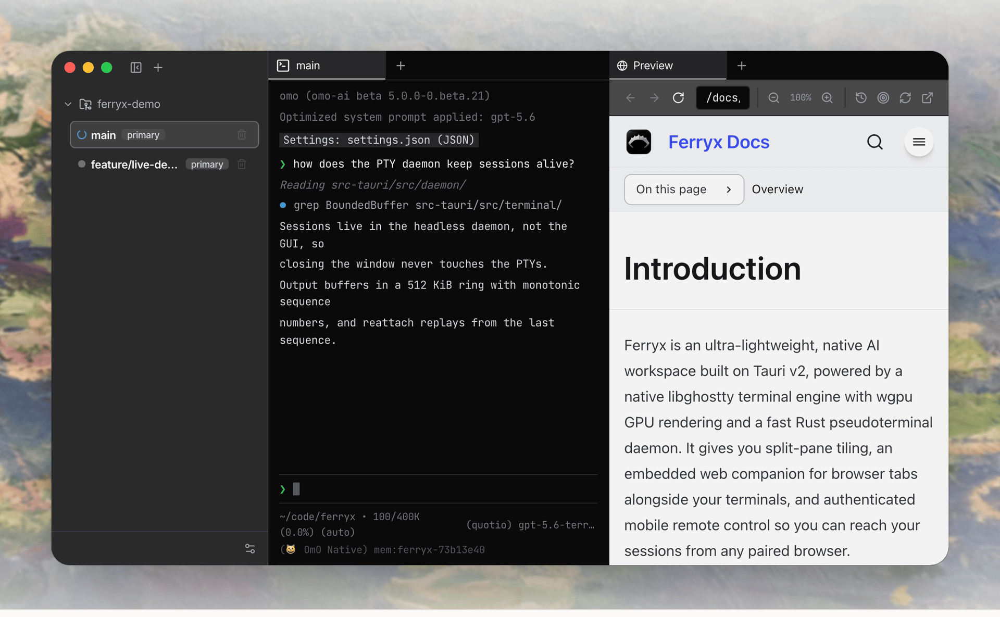

<div align="center">

[English](README.md) | [简体中文](README.zh-CN.md)


# Ferryx

### A native terminal for coding agents on macOS, Windows and Linux.

Claude Code, Codex and any CLI agent keep running when you close the app, remote Linux boxes
connect without SSH, and every tab shows which agent is waiting on you. Native Rust on Tauri v2
with a libghostty terminal core; no Electron. A lane supervisor is on `main` for the next release.

[**Download**](https://github.com/Indosaram/ferryx/releases/latest) &nbsp;·&nbsp;
[**Website**](https://ferryx.dev/) &nbsp;·&nbsp;
[**Docs**](https://ferryx.dev/docs/introduction/) &nbsp;·&nbsp;
[**Discord**](https://discord.gg/Z2hBkQEHUG)

<br />



<sub>An agent working in a native terminal pane, split beside an embedded browser tab.</sub>

</div>

---

## Download

| Platform | Package | |
| :--- | :--- | :--- |
| **macOS** | Universal DMG (Apple Silicon & Intel) | [`.dmg`](https://github.com/Indosaram/ferryx/releases/latest/download/Ferryx_universal.dmg) |
| **Windows** | Microsoft Store (Primary) / Installer (Secondary) | [Store](https://apps.microsoft.com/detail/9NLHQL5JNLM4) / [`.exe`](https://github.com/Indosaram/ferryx/releases/latest/download/Ferryx_x64-setup.exe) |
| **Linux** | Portable AppImage (x64) | [`.AppImage`](https://github.com/Indosaram/ferryx/releases/latest/download/Ferryx_amd64.AppImage) |
| **Linux** | Debian / Ubuntu package (x64) | [`.deb`](https://github.com/Indosaram/ferryx/releases/latest/download/Ferryx_amd64.deb) |
| **Linux (Headless)** | Server / VPS PTY Daemon & CLI (x64 only; arm64: [build from source](CONTRIBUTING.md#build-prerequisites)) | [`install.sh`](https://relay.ferryx.dev/install.sh) (`curl -fsSL https://relay.ferryx.dev/install.sh \| bash`) |

The macOS, Windows, and Linux links resolve against the latest release. Local release assembly
stages the headless `ferryx-cli` beside the Linux AppImage and `.deb` (as
`ferryx-cli-linux-amd64`) and, when the universal macOS CLI is present, as
`ferryx-cli-darwin-universal`, so the one-line installer above resolves a current artifact when
the release publishes one and otherwise fails closed. No prebuilt `ferryx-cli` exists for Linux
arm64; the installer exits with code 2 there and points to the source build. The installers
check the downloaded `ferryx-cli` against the release's `SHA256SUMS` and refuse a mismatch.
Verify other downloads with the checksums published alongside the binaries:

```bash
sha256sum -c SHA256SUMS.txt
```

## Speed. Isolation. Total control.

Every layer is engineered for minimal latency and autonomous agent collaboration.

### Native Ghostty & wgpu engine

Desktop terminal panes render through native libghostty and a GPU-accelerated wgpu
pipeline, giving crisp font rasterization and low-latency throughput.

- libghostty terminal core
- wgpu GPU pipeline
- Measured render latency: see [Performance](#performance)

### Multi-agent workspaces

Run parallel AI coding agents (OmO, Claude Code, Codex, Antigravity, OpenCode, pi, omp, GJC,
GitHub Copilot CLI, Cursor CLI, Grok, Kimi, Cline, Aider, Crush, Droid) in isolated split
panes with real-time status indicators.

- Isolated worktree per agent
- Live status indicators
- Launch straight from the tab bar

### Flexible split-pane tiling

Arbitrary vertical and horizontal splits with pointer-drag resizing and smooth layout
transitions.

- Vertical and horizontal splits
- Pointer drag resizing
- Drag tabs into any pane

### Mobile web pairing

Authenticated remote access after you sign in to your Ferryx account. Stream terminal output to a dependency-free
DOM terminal grid and steer agents from anywhere.

- Account sign-in via email magic link
- Streamed terminal grid
- Steer agents from a phone

### Remote Linux machine pairing (No SSH required)

Pair headless Linux servers, VPSs, and cloud instances as project-owning machines.
Ferryx uses an outbound-only relay tunnel, so machines behind NAT, firewalls, or without
public IPs / open SSH ports connect seamlessly.
When both machines can reach each other over UDP, a paired session also moves onto a direct,
end-to-end encrypted QUIC path without dropping the terminal, and falls back to the relay if
that path breaks. The relay stays the baseline; the direct path is opportunistic.
To operate your own relay instead of the default service, follow the
[self-hosted relay guide](https://ferryx.dev/docs/self-hosted-relay/) for TLS, mail delivery,
machine enrollment, and the separate desktop account and gateway settings.

- Headless `ferryx-cli` needs no display server and links no GTK, WebKitGTK, or JavaScriptCore; on Linux it needs only glibc (`libc`, `libm`, `libgcc_s`)
- Outbound encrypted relay tunnel: no inbound SSH, open ports, or public IP needed
- Native terminal split-panes and remote Git worktrees run directly on the machine

```bash
# 1. One-line install ferryx-cli on the remote machine (Linux x64, macOS)
curl -fsSL https://relay.ferryx.dev/install.sh | bash

# 2. Start the headless PTY daemon in a dedicated service or terminal;
#    use a second terminal for step 3 while this foreground process runs.
ferryx-cli --daemon

# 3. Link machine to your account via email magic link (no open ports or GUI PIN copying needed)
ferryx-cli account login --email you@example.com --origin https://your-account-service.example
# Open the authorization link in your email; the command waits for approval.
# --origin may be omitted when FERRYX_ACCOUNT_ORIGIN is configured.
```

### Zero Electron overhead

Tauri v2 with the platform's native WebKit or WebView2 engine, paired with a headless
Rust PTY daemon. The core runs on macOS, Windows, and Linux; selected OS integrations
such as launchd, Dock badges, color emoji, and vibrancy remain macOS-first.

- Tauri v2 shell
- Headless Rust PTY daemon
- macOS, Windows, Linux

### Resilient persistence

Workspace state snapshots automatically and the GUI can reattach to a running daemon.
Closing the GUI leaves daemon-owned processes running; stopping the daemon or rebooting
the host can still end live PTYs.

- Layout snapshots
- Daemon survives the GUI
- Reattach with output replay

## Is Ferryx for you?

Ferryx is a good fit if you:

- run more than one CLI coding agent (for example Claude Code and Codex) on the same repository and want one worktree convention for all of them;
- want agent sessions to keep running after you close the window, and to replay missed output when you come back;
- want to check on or steer a long agent run from your phone;
- are an individual or a company small enough to use it free (see the [license FAQ](https://ferryx.dev/docs/license/)).

Ferryx is probably not for you yet if you:

- use a single agent vendor. `claude --worktree` or Codex's built-in worktrees already isolate that vendor's sessions, with less to install;
- need SSO, centrally managed accounts, or a cloud-hosted service. Ferryx does not offer them today;
- need prebuilt Linux or Windows ARM64 binaries, or run on a host without a GPU adapter. Those are not supported yet.

## Performance

The figure below is a single offscreen measurement, not a comparison with other terminals.

- Offscreen WGPU render benchmark, 50 frames, 800x480 px: p50 3.10 ms, p95 4.34 ms.
- Hardware: Apple M4 Max (Metal, integrated GPU), macOS.
- Source: [`bench/terminal/evidence/native-wgpu-phase2-summary.md`](bench/terminal/evidence/native-wgpu-phase2-summary.md).

Reproduce the render figure:

```bash
cargo run --manifest-path src-tauri/Cargo.toml \
  --bin native_terminal_renderer_poc -- \
  --headless --output bench/terminal/evidence/native-wgpu-phase2-latest.png
```

Run the terminal parser and throughput baseline suite (writes `bench/terminal/evidence/baseline-*`):

```bash
bun run bench/terminal/runner.ts
```

Numbers depend on hardware; run both on your own machine before relying on them.

## Built different

An architecture inventory of Ferryx's native Ghostty and Rust components. This is not a
performance benchmark against Electron-based AI IDEs or terminal emulators.

| Architecture component | Ferryx implementation |
| :--- | :--- |
| Terminal parser | libghostty-vt |
| Desktop rendering | WGPU native child surfaces |
| PTY lifecycle | Headless Rust daemon with output replay |
| Embedded browser | Native WebView split-tabs |
| Mobile pairing | Account sign-in gateway with a custom DOM terminal grid |
| Agent supervision | Manifest-driven status detection and notifications |

## Guides and comparisons

Practical walkthroughs:

- [Running coding agents in parallel](https://ferryx.dev/use-cases/parallel-ai-agents/) — why agents collide in a shared working directory, and how a worktree per agent fixes it
- [Git worktrees in practice](https://ferryx.dev/use-cases/git-worktree-workflow/) — the manual commands, and where the manual flow gets tedious
- [Remote terminal access](https://ferryx.dev/use-cases/remote-terminal-access/) — checking a long run from your phone

Honest comparisons against the alternatives, on architecture and licensing rather than
unmeasured performance claims:

- [Ferryx vs Warp](https://ferryx.dev/compare/warp/)
- [Ferryx vs Wave Terminal](https://ferryx.dev/compare/wave-terminal/)
- [Ferryx vs Conductor](https://ferryx.dev/compare/conductor/)
- [Ferryx vs Crystal / Nimbalyst](https://ferryx.dev/compare/crystal/)
- [Ferryx vs tmux + git worktree](https://ferryx.dev/compare/tmux-git-worktree/)
- [Ferryx and Ghostty](https://ferryx.dev/compare/ghostty/) — Ferryx embeds libghostty-vt; it is not a Ghostty competitor

## Docs and support

- [User guide](https://ferryx.dev/docs/guide/): first run, workspaces and worktrees, panes, remote access, and agents
- [Troubleshooting](https://ferryx.dev/docs/troubleshooting/): guides indexed by symptom
- [Privacy declaration](https://ferryx.dev/privacy/)
- [Security policy](SECURITY.md): how to report a vulnerability privately, supported versions, threat model
- [Contributing](CONTRIBUTING.md): build prerequisites, test commands, and the license for contributions
- [Changelog](CHANGELOG.md): changes per release tag
- [Roadmap](ROADMAP.md): what is being worked on now, next, and later
- Questions: [Discord](https://discord.gg/Z2hBkQEHUG)

## Build from source

### Prerequisites

- [Bun](https://bun.sh/) 1.1+
- [Rust](https://www.rust-lang.org/) stable (at least 1.82)
- [Node.js](https://nodejs.org/) 20+
- [Zig](https://ziglang.org/download/) 0.17.0 (required for the pinned Ghostty build)
- [Tauri CLI v2](https://v2.tauri.app/start/prerequisites/)

On Linux, install the GTK 3, WebKitGTK 4.1, and other system libraries required by
[Tauri](https://v2.tauri.app/start/prerequisites/) before compiling the desktop app. The
headless CLI builds without them:
`cargo build --manifest-path src-tauri/Cargo.toml --release --no-default-features --bin ferryx-cli`.

### Clone and install

```bash
git clone https://github.com/Indosaram/ferryx.git
cd ferryx
git submodule update --init --recursive
bun install
bun install --cwd ui
bun install --cwd site
```

### Fetch the bundled agent runtime (mhc + bun)

The hub runs its Slack, cron and judge turns through [mhc](https://github.com/Indosaram/mhc),
and mhc's eval and bash tools need [bun](https://github.com/oven-sh/bun). Every desktop package
ships both. The versions and their sha256 values are pinned in `src-tauri/resources/mhc/pin.json`.
One command downloads both from their public GitHub releases for your machine. It verifies the
mhc minisign signature and the sha256 of both files, then places them in the gitignored
`src-tauri/resources/mhc/payload/<target triple>/`:

```bash
bun scripts/fetch-mhc.mjs
```

The command is idempotent: it skips a download that is already present and verified.
`--target <triple>` fetches for another platform, and `--target universal-apple-darwin` fetches
both macOS slices. Release builds run it automatically: `cargo tauri build` calls it from
`beforeBuildCommand`. A dev build works without it. The hub then uses `FERRYX_HUB_MHC_BIN`
when set, else `mhc` from your PATH.

### Run the desktop app

The Tauri shell starts the UI dev server defined in `src-tauri/tauri.conf.json`:

```bash
cd src-tauri && cargo tauri dev
```

### Run the site and docs

Astro + Starlight on port 14173:

```bash
bun run --cwd site dev
```

- Landing page: <http://localhost:14173/>
- Documentation: <http://localhost:14173/docs/introduction/>
- Shortcut reference: <http://localhost:14173/docs/shortcuts/>

### Validate changes

```bash
bun run --cwd ui build
bun run --cwd ui test
BASE_URL=/ bun run --cwd site build
cargo check --manifest-path src-tauri/Cargo.toml
```

## Architecture

```text
ferryx/
├── src-tauri/   # Rust Tauri v2 core: PTY daemon, IPC, notifications, remote gateway
├── ui/          # React frontend: native terminal surface, layout, remote pairing
├── site/        # Astro + Starlight landing page and docs, deployed to Cloudflare Workers
└── docs/        # Specifications, audit logs, and reference material
```

**Rust native core (`src-tauri`)** owns pseudoterminal lifecycles, manages Git worktree
leases, hosts native child webviews, and runs an authenticated Axum WebSocket gateway
for mobile pairing. Terminal sessions live in a headless daemon rather than the GUI, so
closing the window never touches a PTY. Output lands in a ring buffer with monotonic
sequence numbers, and reattaching replays from the last sequence.

**Frontend (`ui`)** is the React shell rendered inside WebKit or WebView2. It drives pane
tiling, agent title detection, keyboard shortcuts, and terminal search overlays.

**Site (`site`)** is the static Astro and Starlight build that hosts the landing page,
guides, and an embedded demo running the real product components.

## Contributing

Contributions are welcome. Branch from `main`, run the validation commands above, sign the
[CLA](CLA.md), and open a pull request describing the user-visible result.

Questions and ideas are welcome in [Discord](https://discord.gg/Z2hBkQEHUG).

## License

This project is source-available under the [Ferryx License](LICENSE). It is free for personal use, education, open-source work, non-profits, and companies with fewer than 50 people and less than USD 5M in annual revenue. Larger companies need a Team subscription to use Ferryx for work, after a transition period that ends 90 days after the Team plan opens. Self-hosted relays stay free for everyone. Releases published before this change remain under the Sustainable Use License (SUL-1.0) they shipped with. The [license FAQ](https://ferryx.dev/docs/license/) lists common allowed and disallowed cases with the clauses that govern them. Contributions require signing the [CLA](CLA.md); see [CONTRIBUTING.md](CONTRIBUTING.md).

## Code Signing Policy

- **Maintainer**: [@Indosaram](https://github.com/Indosaram)
- **Privacy**: Ferryx stores workspace data locally. Remote access, embedded websites, external coding agents, and update services can exchange data over the network. See the [Ferryx Privacy Policy](https://ferryx.dev/privacy/) for data handling and deletion choices.
